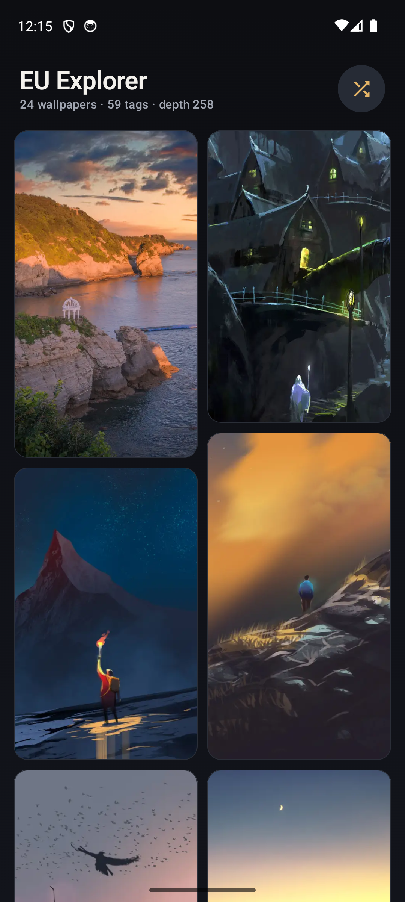
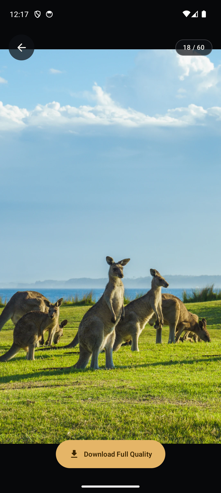
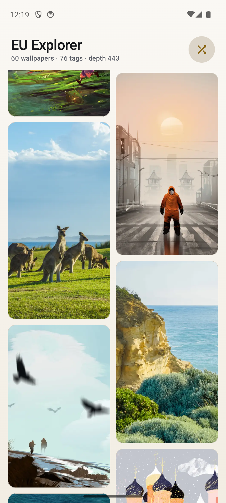
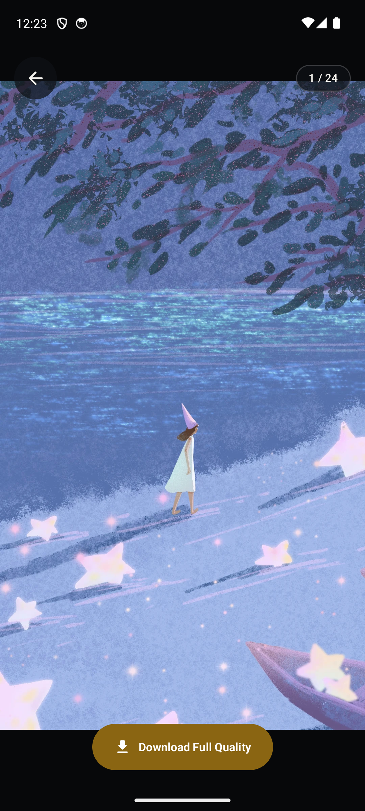

<div align="center">

# MIUI EU Wallpaper Explorer

**An ultra-minimal Android Jetpack Compose app for endlessly exploring the full depth and breadth of Xiaomi's EU Theme Store wallpaper catalog.**

[](https://kotlinlang.org)
[](https://developer.android.com/compose)
[-3DDC84?style=for-the-badge&logo=android&logoColor=white)](https://developer.android.com)
[-0F9D58?style=for-the-badge&logo=android&logoColor=white)](https://developer.android.com)
[](#)

</div>

---

## Overview

**MIUI EU Wallpaper Explorer** strips away multi-provider bloat, accounts, analytics, local databases, and editing overlays down to two pure screens:

1. **EU Explorer (`ExplorerScreen`):** Launches straight into an unlimited, deduplicated random staggered grid sourced directly from Xiaomi's official EU Theme Store (`api.zhuti.xiaomi.com`).
2. **Pure Fullscreen Viewer (`FullscreenScreen`):** Swipe horizontally across the endless feed, pinch or double-tap to zoom, tap to hide controls, and hit **Download Full Quality** to save the raw uncompressed master straight to `Pictures/EU Wallpapers/`.

---

## Key Features

- **Full Depth (`cardStart = 0..832`) & Full Breadth:** Samples across 50+ seed categories, the unfiltered global EU stream (`tag=""`), and dynamically harvested `tags`, `metaTags`, `innerTags`, and `authorName` portfolios (up to 600 active tags).
- **Self-Calibrating Sampling Engine:** Tracks per-tag depth ceilings automatically, binary-halving when a deep probe overshoots a niche tag and pruning empty tags so endless scrolling never stalls.
- **Zero-Duplicate Session Stream:** Deduplicates globally by both product `uuid` and CDN `hash` across concurrent batches.
- **Uncompressed Master Downloads:** Streams `/download/ThemeMarket/{hash}`, sniffs real magic bytes (`JPEG` / `PNG` / `WEBP`) despite `application/octet-stream` CDN headers, and writes atomically via `MediaStore` (`IS_PENDING`).
- **Lightweight & Zero-Bloat:** Pure Compose + Retrofit + OkHttp + Coil 3 with custom inline vector drawables (no `material-icons-extended`, no Room, no WorkManager, no ads, no tracking).

---

## Screenshots

| Explorer (Dark) | Fullscreen (Dark) | Explorer (Light) | Fullscreen (Light) |
| :---: | :---: | :---: | :---: |
|  |  |  |  |

---

## How It Works (Architecture & API Brief)

```
┌───────────────────────────┐      GET /app/v9/uipages/search/tag      ┌───────────────────────────┐
│      ExplorerScreen       │ ◄─────────────────────────────────────── │   api.zhuti.xiaomi.com    │
│ (Adaptive Staggered Grid) │   3x concurrent random (tag, cardStart)  │   (Xiaomi EU Zhuti V9)    │
└─────────────┬─────────────┘                                          └───────────────────────────┘
              │ Tap Wallpaper (Shared Session StateFlow)
              ▼
┌───────────────────────────┐      GET /thumbnail/webp/w480q80|w1080   ┌───────────────────────────┐
│     FullscreenScreen      │ ◄─────────────────────────────────────── │    t17.market.mi-img.com  │
│ (Pager + Pinch/Tap Zoom)  │ ─────► GET /download/ThemeMarket/{hash}  │     (Xiaomi Media CDN)    │
└───────────────────────────┘   Sniffs JPEG/PNG/WEBP -> MediaStore     └───────────────────────────┘
```

### API Summary
- **Catalog endpoint:** `https://api.zhuti.xiaomi.com/app/v9/uipages/search/tag?type=WALLPAPER&tag={tag}&cardCount=1&cardStart={page}&region=EU` with header `User-Agent: MiuiTheme/2.2.0 (Linux; U; Android 14; Mobile; en-US)`.
- **`cardStart` is a 0-based page index (`0..832`)**, returning 12 items per card (up to `9,996` items per tag).
- **3-tier CDN delivery on `t17.market.mi-img.com`:**
  - `w480q80` WebP for instant grid thumbnails
  - `w1080` WebP for crisp fullscreen viewing (reusing the cached grid thumbnail as placeholder)
  - `/download/ThemeMarket/{hash}` for raw, uncompressed original camera/design masters

Read the complete endpoint specification, schema breakdown, and engine algorithm in **[docs/API.md](docs/API.md)**.

---

## Install or Build from Source

### Prebuilt APK
Download the latest debug APK from **[GitHub Releases](../../releases)** and install it on Android 8.0+ (API 26+).

### Build Locally
```bash
git clone https://github.com/v0idspace/miui-eu-wallpaper-explorer.git
cd miui-eu-wallpaper-explorer

# Run unit tests, Compose/Android lint, and build debug APK
./gradlew testDebugUnitTest lintDebug assembleDebug
```
*(On Windows PowerShell, use `.\gradlew.bat`.)*

---

## Project Structure

```text
app/src/main/java/com/miui/euexplorer/
├── EuExplorerApp.kt                        # Coil 3 ImageLoader + AppContainer init
├── MainActivity.kt                         # Edge-to-edge + Type-Safe Navigation host
├── di/AppContainer.kt                      # Singleton OkHttp, Retrofit, Engine & Downloader
├── domain/WallpaperItem.kt                 # Domain model + ThemeMarket hash/URL mapper
├── data/
│   ├── EndlessRandomCatalogEngine.kt       # 0..832 depth calibration + dynamic tag expansion
│   ├── WallpaperRepository.kt              # Shared endless feed StateFlow
│   ├── FullQualityDownloader.kt            # Magic-byte detection + MediaStore writer
│   └── remote/                             # ZhutiApiService, DTOs, BOM & backoff interceptors
└── ui/
    ├── explorer/                           # ExplorerScreen & ExplorerViewModel
    ├── fullscreen/                         # FullscreenScreen & FullscreenViewModel
    ├── navigation/Routes.kt                # @Serializable routes
    └── theme/                              # Quiet Obsidian Studio & Archival Paper M3 themes
```

---

## Disclaimer

This project is an independent open-source client for exploring publicly accessible wallpapers served by Xiaomi's Theme Store CDN. All wallpaper artwork and trademarks belong to Xiaomi Inc. and their respective creators.
