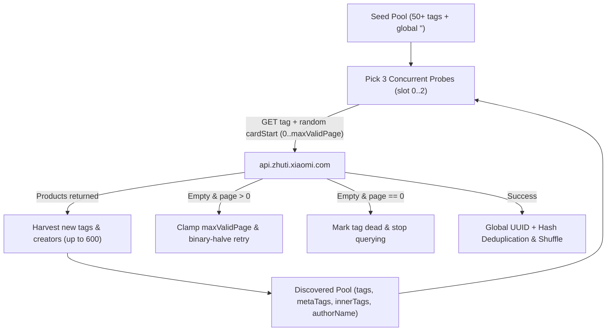

# Xiaomi EU Theme Store (Zhuti V9) Wallpaper API Specification

This document summarizes the live-verified Xiaomi Zhuti V9 endpoints and CDN delivery pipeline used by **MIUI EU Wallpaper Explorer**.

---

## 1. Catalog Search Endpoint

- **Method:** `GET`
- **URL:** `https://api.zhuti.xiaomi.com/app/v9/uipages/search/tag`
- **Authentication:** None (public unauthenticated access)

### Required Headers
```http
User-Agent: MiuiTheme/2.2.0 (Linux; U; Android 14; Mobile; en-US)
Accept: application/json
```

### Query Parameters

| Parameter | Required | Value | Notes |
| :--- | :--- | :--- | :--- |
| `type` | Yes | `WALLPAPER` | Restricts results strictly to wallpapers |
| `tag` | Yes | String (e.g. `Nature`, `Dark`, or `""`) | Empty string `""` returns the unfiltered global EU stream |
| `cardCount` | Yes | `1` | Each card contains 12 product items |
| `cardStart` | Yes | `0..832` | **0-based page/card index** (`0` = items `0..11`, `1` = `12..23`) |
| `region` | Recommended | `EU` | Selects the European international catalog |

### Pagination Depth Behavior
- Xiaomi's search backend enforces a 10,000-document window per query: **`cardStart = 0..832`** yields up to `833 × 12 = 9,996` items per tag. `cardStart = 833` always returns `0` products and `hasMore = false`.
- **Per-tag depth varies widely:**
  - Broad tags (`""`, `Nature`, `Landscape`, `Car`, `Animal`, `Mountain`, `AI Generated`, `Blue`, `Red`, `Water`, `VCG`) reach `cardStart = 832`.
  - Mid-depth tags (`City`, `Space`, `Ocean`, `Night`, `Black`, `Dark`, `Anime`) span roughly `100..600` pages.
  - Niche tags (`AMOLED`, `Architecture`, `Cyberpunk`, `Geometry`) have `< 10` pages, and unrecognized tags return `0` items at `cardStart = 0`.

### Response Schema (Relevant Fields)
```json
{
  "apiCode": "0",
  "apiMessage": "success",
  "apiData": {
    "hasMore": true,
    "cards": [
      {
        "cardType": "WALLPAPER_ENDLESS_LIST",
        "products": [
          {
            "uuid": "95840f3d-6afa-48d4-b93b-ef060a33db86",
            "productType": "WALLPAPER",
            "name": "Tagong grassland 2",
            "authorName": "VCG",
            "imageUrl": "https://t17.market.mi-img.com/thumbnail/webp/w-60q70/ThemeMarket/0f6f0620f318a41d7ac490be137ec2e1b03e65207",
            "originalImageUrl": "https://t17.market.mi-img.com/thumbnail/webp/w0q70/ThemeMarket/0f6f0620f318a41d7ac490be137ec2e1b03e65207",
            "fileSizeInKB": 1022898,
            "snapshotAspectRatio": null,
            "tags": ["VCG"],
            "metaTags": ["Landscape", "Refreshing", "Pleasant"],
            "innerTags": []
          }
        ]
      }
    ]
  }
}
```
> **Note:** Despite the field name `fileSizeInKB`, the value returned (`1022898`) corresponds to the raw master byte length (`~1.02 MB`).

---

## 2. Media CDN (`t17.market.mi-img.com`)

Extract the 40-character hex hash after `/ThemeMarket/` from `originalImageUrl` or `imageUrl`:

| Tier | URL Pattern | Format & Size | Used For |
| :--- | :--- | :--- | :--- |
| **Grid Thumbnail** | `https://t17.market.mi-img.com/thumbnail/webp/w480q80/ThemeMarket/{hash}` | `image/webp` (~35–70 KB) | Smooth grid scrolling |
| **Fullscreen Preview** | `https://t17.market.mi-img.com/thumbnail/webp/w1080/ThemeMarket/{hash}` | `image/webp` (~330–600 KB) | Crisp fullscreen pager |
| **Native WebP Fallback** | `https://t17.market.mi-img.com/thumbnail/webp/w0/ThemeMarket/{hash}` | `image/webp` (~600 KB–1.1 MB) | Fallback if `/download/` fails |
| **Raw Uncompressed Master** | `https://t17.market.mi-img.com/download/ThemeMarket/{hash}` | Raw JPEG/PNG/WebP master (1–8 MB) | Full-quality MediaStore download |

### CDN Implementation Quirks
1. **Use `GET`, not `HEAD`:** Uncached dynamic transcodes under `/thumbnail/webp/w1080/` can return `404` to `HEAD` while succeeding with `200 OK` on `GET`.
2. **Magic-Byte Format Detection:** `/download/ThemeMarket/{hash}` responds with `Content-Type: application/octet-stream`. `FullQualityDownloader` peeks the first 16 bytes (`FF D8 FF` → `.jpg`, `89 50 4E 47` → `.png`, `RIFF....WEBP` → `.webp`) before creating the `MediaStore` entry.
3. **Backoff & Timeouts:** Uncached CDN transcodes occasionally exceed 10s or trigger HTTP `429`/`504` bursts; the client uses a 25s read timeout and `RateLimitBackoffInterceptor` with jittered exponential backoff.

---

## 3. How `EndlessRandomCatalogEngine` Explores Full Depth & Breadth



- **Full Depth (`0..832`):** Every tag starts optimistically at `maxValidPage = 832` so the very first scroll already samples deep pages instead of repeating page `0`. When an optimistic deep probe overshoots a narrow tag, it clamps `maxValidPage` and halves down automatically until hitting valid results.
- **Full Breadth:** Every incoming wallpaper feeds its `tags`, `metaTags`, `innerTags`, and `authorName` back into the active sampling pool, continuously discovering niche collections and studio portfolios across the EU catalog.
